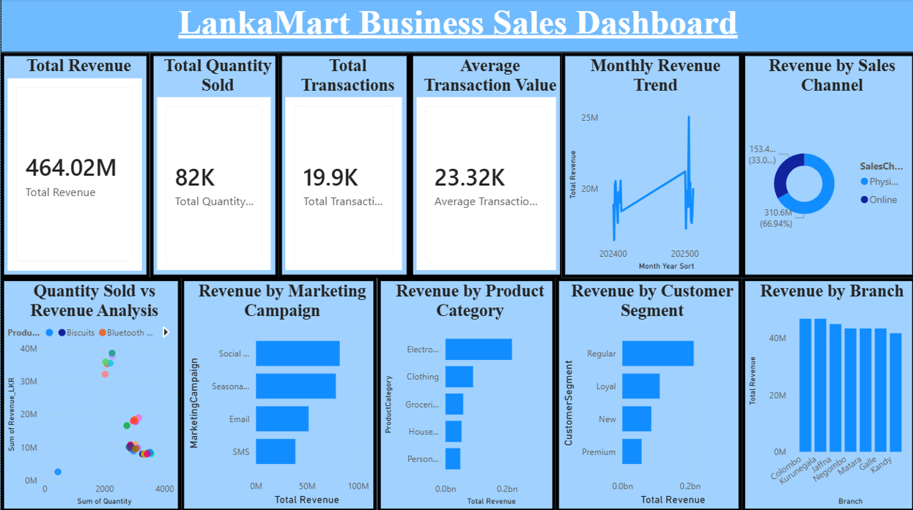
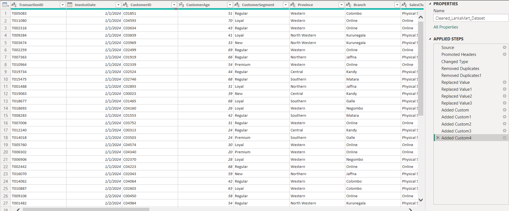
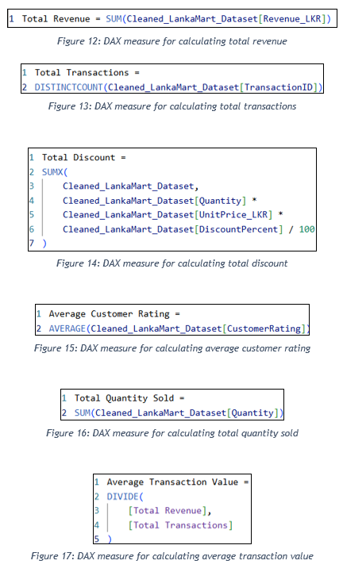
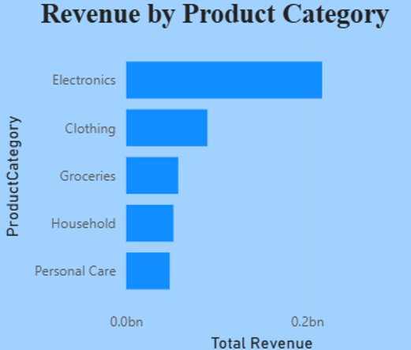
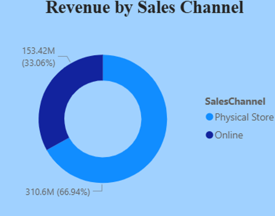

# 🛒 LankaMart Retail BI Dashboard

An interactive **Power BI** sales dashboard for **LankaMart Retail Group**, a Sri Lankan retailer with physical stores and an online platform. It turns raw transaction data into KPIs and revenue insights to support data-driven decisions.

## 📌 Project Overview

Completed for **Unit 26: Big Data Analytics and Visualisation** (Pearson BTEC HND in Computing). In the scenario, I acted as a Junior Data Analyst at a consultancy asked to show how analytics could replace LankaMart's reliance on spreadsheets and static reports.

## ❓ Business Questions

- Which product categories generate the most revenue?
- Which branches perform best?
- Which customer segments contribute most revenue?
- Which marketing campaigns are associated with higher revenue?
- Which sales channel generates the most revenue?
- Which products generate the most revenue?
- How does revenue change over time?
- Are there unusual relationships between quantity sold and revenue?

## 🧹 Data Preparation (Power Query)

The transaction dataset includes transaction ID, invoice date, customer ID, age and segment, province, branch, sales channel, product name and category, quantity, unit price, discount, revenue (LKR), customer rating, and marketing campaign.

Transformation steps applied in Power Query:

- Promoted headers and set correct data types
- Removed duplicate records
- Replaced missing values: **"Unknown Customer"** for missing `CustomerID` and **"Unknown Product"** for missing `ProductName`, which keeps valid sales instead of deleting whole records (trade-off: those rows can't be traced to a specific customer or product)
- Added custom columns, such as a month-year sort key for the trend chart

## ⚙️ DAX Measures

Reusable measures that update automatically as filters change:

| Measure | Purpose |
|---|---|
| Total Revenue | Sum of revenue (LKR) |
| Total Transactions | Distinct count of transaction IDs |
| Total Quantity Sold | Sum of units sold |
| Average Transaction Value | Total revenue ÷ total transactions |
| Average Customer Rating | Mean customer rating |
| Total Discount | Discount value across all sales |

## 📊 Key Findings

| KPI | Value |
|---|---|
| Total Revenue | LKR 464.02 million |
| Total Transactions | about 19.9K |
| Total Quantity Sold | about 82K units |
| Average Transaction Value | about LKR 23.32K |

### Revenue by product category
Electronics generates the most revenue, followed by Clothing, Groceries, Household and Personal Care.

### Revenue by sales channel
Physical stores earn LKR 310.6M (66.94%) and online sales LKR 153.42M (33.06%), so online is already about a third of revenue.

### Other insights
- **Branches:** Revenue is fairly even across the 7 branches. Colombo and Kurunegala are strongest and Kandy is lowest.
- **Customer segments:** Regular customers contribute the most revenue, followed by Loyal, New and Premium.
- **Marketing:** Social Media is associated with the highest revenue, followed by Seasonal Promotions, Email and SMS. This is an association, not proof of cause, since seasonality and demand also matter.
- **Top products:** USB Cable, Keyboard and Power Bank.

## 💡 Recommendations

1. Plan stock and promotions around high-performing Electronics products
2. Prioritise customer-retention programmes for Regular and Loyal customers
3. Investigate Social Media campaign effectiveness before increasing spend
4. Grow online sales while protecting physical-store performance
5. Improve collection of customer and product identifiers
6. Replace static spreadsheets with interactive dashboards

## 📄 Documentation

- [Project report extract: analysis and findings (docx)](docs/big-data-report-extract.docx)

## 📂 Repository Contents

| File | Description |
|---|---|
| `LankaMart_Dashboard.pbix` | Power BI file (open with Power BI Desktop) |
| `images/` | Dashboard and process screenshots |
| `docs/` | Report extract |

## 👤 Author

**Afry Nizam**: BSc Information Technology student, University of West London
[LinkedIn](https://www.linkedin.com/in/afrynizam) · [GitHub](https://github.com/afrynizam07)
